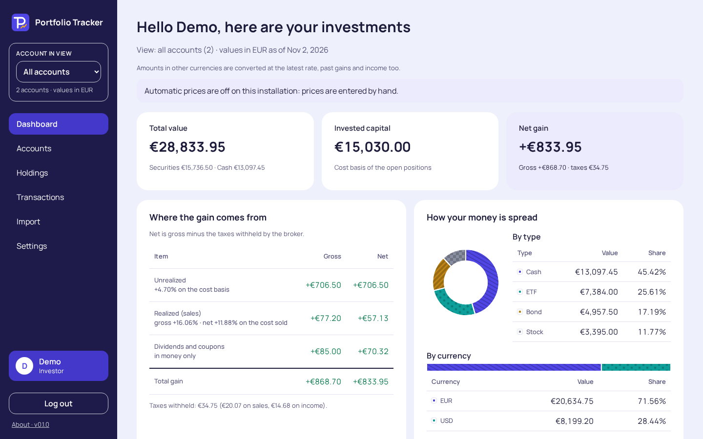
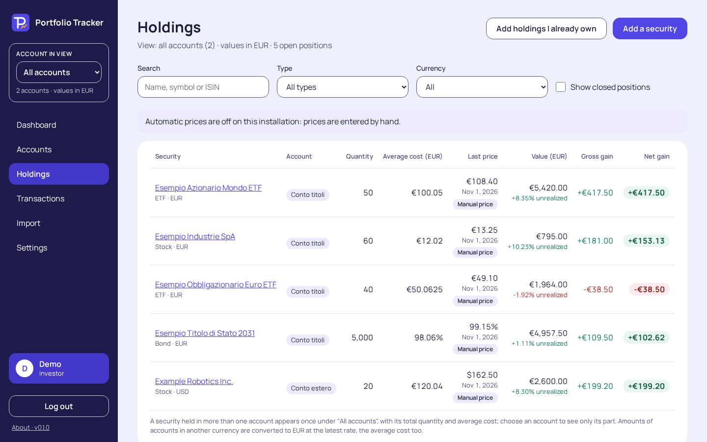
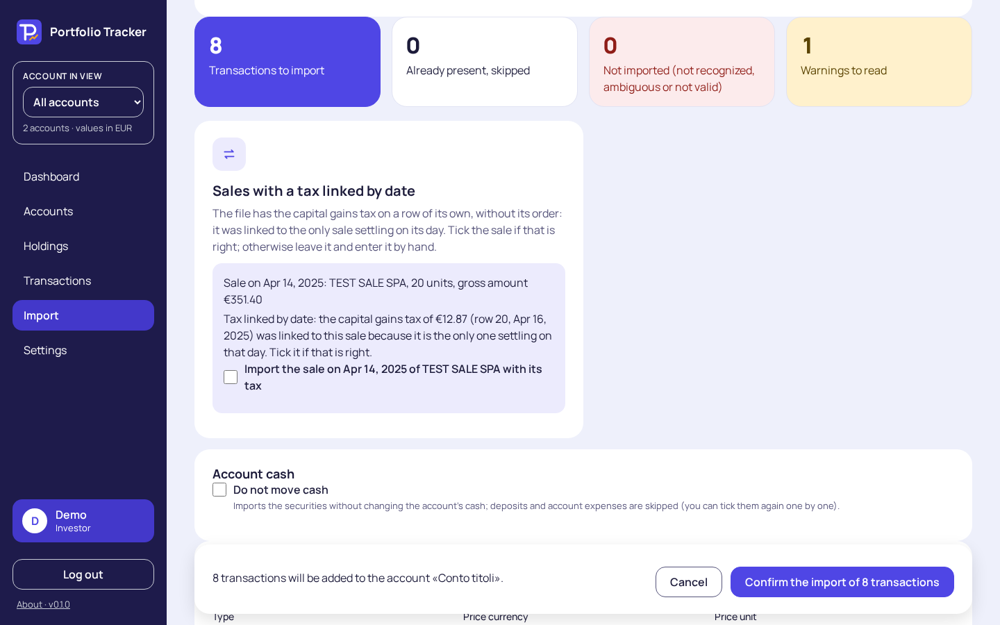

#  Portfolio Tracker

A self-hosted, open-source investment tracker for private investors. It answers one question: **"How are my investments performing?"** with a clear, jargon-free dashboard. ETFs, stocks and bonds across several broker accounts, in one app that runs on your own computer, server or NAS. It only monitors: it never trades.



## What you can do
- **Keep all your broker accounts in one place,** each in its own currency, and see the whole portfolio in your reporting currency.
- **Record your transactions:** buys, sells, dividends, coupons, deposits, withdrawals and stock splits. Type them in, edit them one by one or in bulk, and export them as CSV.
- **Import** Directa Excel exports and the app's own CSV, always with a preview to check before anything is saved.
- **See each holding** with its average cost, last price, value and gain, **before and after taxes**, plus the dividends and coupons it paid.
- **Follow the dashboard:** the figures that matter, how your money is spread by security, type and currency, your best and worst holdings, and your income by month and year.
- **Get prices automatically:** daily closing prices and ECB exchange rates, downloaded in the background. Enter your own prices where there is no automatic one (bonds, for example), or turn downloads off completely.
- **Share it with your household:** several users on one installation, each seeing only their own portfolio. Italian and English, four colour themes.
- **Back up and restore** the whole installation with one command.





*The screenshots use invented demo data.*

## What is planned
Ideas for later versions, in no fixed order and without dates:
- charts of how your portfolio and each holding changed over time;
- two-factor sign-in;
- a dark theme;
- backup and restore from the app's screens, with encrypted backups;
- settings screens for security and for the price sources;
- a layout for phones.

## What you need
- **Docker with Docker Compose,** on a machine with an x86-64 (Intel or AMD) processor: a PC, a server, or a NAS that supports Docker. The image is built for `linux/amd64` only, so ARM machines (such as a Raspberry Pi) are not supported.
- **A terminal** on that machine, to run a few commands.

## Install it, step by step
1. **Make a folder for the app** and go into it:
   ```bash
   mkdir portfolio-tracker
   cd portfolio-tracker
   ```
2. **Download the compose file** into it:
   ```bash
   curl -fsSL -o docker-compose.yml https://raw.githubusercontent.com/Horo86/portfolio-tracker/v1.0.0-rc.2/docker-compose.example.yml
   ```
   <details>
   <summary>The whole file, to read before you download it</summary>

   ```yml
   # Portfolio Tracker: save this file as docker-compose.yml in a folder of its own.
   # Before the first start, in that folder: mkdir data   (owned by the user that runs the app)
   # PUID/PGID default to 1000 (the first user on most Linux systems); check yours with `id`.
   services:
     portfolio-tracker:
       image: ghcr.io/horo86/portfolio-tracker:1.0.0-rc.2
       platform: linux/amd64
       container_name: portfolio-tracker
       user: "${PUID:-1000}:${PGID:-1000}"
       ports:
         # This computer only. To open it from other devices on your network, use the line below
         # instead, and read "Opening it from other devices" in the README first.
         - "127.0.0.1:8000:8000"
         # - "8000:8000"
       volumes:
         - ./data:/data
       environment:
         PT_LOG_LEVEL: INFO
         # The session cookie is Secure: serve the app over HTTPS (reverse proxy) or open it
         # on localhost. Only on a trusted LAN over plain http: PT_COOKIE_SECURE: "false"
         # Key for provider credentials; without it one is generated in data/secrets/secret.key.
         # PT_SECRET_KEY: "<output of: openssl rand -base64 32>"
         # Behind a reverse proxy only: its address or network, so the login throttle and the
         # audit log see the real client (README, Security). Empty = no proxy. Never 0.0.0.0/0.
         # PT_TRUSTED_PROXIES: "172.18.0.2"
         # Market data: "false" makes no outbound call at all; the daily run is at 22:00 UTC.
         # PT_MARKET_DATA: "false"
         # PT_MARKET_DATA_TIME: "22:00"
       healthcheck:
         # The same check as the image's, written out here so it can be seen and tuned.
         test: ["CMD", "python", "-c", "import os, urllib.request; urllib.request.urlopen('http://127.0.0.1:' + os.environ.get('PT_PORT', '8000') + '/api/health', timeout=4)"]
         interval: 30s
         timeout: 5s
         start_period: 15s
         retries: 3
       restart: unless-stopped
       # Gives a market data download in progress time to end on `docker compose stop` (no new
       # provider call starts once stopping; a very slow answer is cut and retried next run).
       stop_grace_period: 30s
       # One container per data folder: never start a second one on the same ./data.
   ```

   </details>
3. **Make the data folder,** where the app keeps everything:
   ```bash
   mkdir data
   ```
   The app runs as user and group `1000` unless you say otherwise. Run `id` to see your own numbers (`uid=…` and `gid=…`). If they are not `1000`, create a file named `.env` next to `docker-compose.yml` with your numbers, for example:
   ```
   PUID=1001
   PGID=1001
   ```
   On a NAS the numbers are often different, for example `uid=1032` and a group `gid=65537`: then the `.env` file says `PUID=1032` and `PGID=65537`.
   The `data` folder must belong to that user: if you created it as another user, run `sudo chown -R <uid>:<gid> data`.
4. **Check the few lines that matter** in `docker-compose.yml`:

   ```yaml
       image: ghcr.io/horo86/portfolio-tracker:1.0.0-rc.2
       user: "${PUID:-1000}:${PGID:-1000}"
         - "127.0.0.1:8000:8000"
         # - "8000:8000"
         - ./data:/data
   ```

   - `image:` the version to run (see [Updating](#updating)).
   - `user:` the user and group the app runs as, taken from `.env` (step 3).
   - **The port.** As downloaded, the app can be opened only on the same machine, at port `8000`. On a server or a NAS that you use from other devices, put a `#` in front of the `127.0.0.1:8000:8000` line and remove it from the `8000:8000` line, then read [Opening it from other devices](#opening-it-from-other-devices). If port 8000 is taken, change the **first** number only, for example `"8080:8000"`.
   - `./data:/data` is the data folder of step 3. To keep the data elsewhere (on a NAS, for example, a shared folder of your choice), put that folder's full path before the colon: `/path/to/your/folder:/data`.
5. **Start it:**
   ```bash
   docker compose up -d
   docker compose ps
   ```
   After a few seconds `docker compose ps` shows the container as `healthy`, and `docker compose logs` shows `application started`.
6. **Open it** in your browser: http://localhost:8000 on the same machine (or the address of [Opening it from other devices](#opening-it-from-other-devices)).
7. **Create the administrator:** on the welcome screen choose "Start from scratch", then enter a username (you log in with it; your e-mail address works too), your first and last name, your e-mail address (kept for later: nothing is sent to it) and a password of at least 12 characters.

### Opening it from other devices
The app's login cookie is sent by browsers only over **HTTPS**, or to `http://localhost`. So opening `http://<the machine's address>:8000` from another device needs one of these:
- **Recommended:** a reverse proxy that serves the app over HTTPS (many NAS systems and routers include one, or use Caddy, nginx or Traefik). Keep the app at the root of its own host name or port, such as `https://portfolio.example.org/`; a sub-path such as `https://example.org/portfolio/` does not work. See [Behind a reverse proxy](#behind-a-reverse-proxy).
- **Only on a trusted home network,** over plain http: add `PT_COOKIE_SECURE: "false"` under `environment:` in `docker-compose.yml`, then `docker compose up -d` again.

Without one of them, the login seems to work and then sends you back to the login page; the log then shows a warning naming `PT_COOKIE_SECURE`.

### If prices or the security search do not work: the Docker network
The container must resolve names and reach the Internet to download prices and exchange rates. If the security search says the price source does not respond, or no price arrives after the daily run, check the Docker network first, then try one of these in `docker-compose.yml`, under the service:
- **Name servers** for the container: `dns: [1.1.1.1, 8.8.8.8]` (any name servers you trust).
- **A Docker network of your own,** if your system's default network has no Internet access (see your system's or NAS's Docker documentation).
- **The host's network,** `network_mode: host`, as a last resort. Then the `ports:` lines are ignored and the app listens on all of the host's addresses: add `PT_HOST: "127.0.0.1"` under `environment:` to keep it on the machine itself, and make sure port 8000 is free there. On Docker Desktop (Windows, macOS) host networking does not work like this.

The example file does not use host networking, on purpose.

## First steps
1. **Accounts:** create one for each broker account, in its currency.
2. **Holdings:** "Add a security" finds one by ISIN or name, or creates it by hand; "Add holdings I already own" enters what you hold today in one go. Or use **Import** for a Directa Excel export or the app's CSV.
3. **Prices:** closing prices and exchange rates arrive with the next daily run, at 22:00 UTC. Until a security has a price it is valued at what it cost. Bonds have no automatic price: enter your own on the holding's page.
4. **Other users:** the administrator adds them in **Administration** → Users, with username, first and last name and e-mail. Each user sees only their own portfolio.

## Prices: what is automatic and what is not

| | |
|---|---|
| **ETFs and stocks** | **Automatic** once the security has an **ISIN**: the closing price of each day, downloaded once a day (at 22:00 UTC unless you change `PT_MARKET_DATA_TIME`), not real time. A security added by name or symbol without an ISIN gets manual prices; add its ISIN later to switch it to automatic prices. |
| **Exchanges** | The main exchanges are recognised: Milan, Xetra, London, Amsterdam, Paris, SIX Swiss, Madrid, Brussels, Vienna and the US exchanges (NYSE, Nasdaq, NYSE Arca, NYSE American, Cboe BZX). Those trading in the security's currency come first ([Configuration](#configuration)). Another exchange is used only when it trades the security in its own currency. |
| **Currencies** | A price is only ever taken in the security's own currency. London prices quoted in pence (GBp) are handled: in pounds or in pence, as you set up the security. |
| **Exchange rates** | **Automatic:** the ECB's daily reference rates. A currency the ECB does not publish has no rate, and totals that need it are shown as partial. |
| **Bonds** | **No automatic prices:** enter them on the holding's page, in percent of the nominal. |
| **Other funds** | Funds that are not ETFs have no type of their own: they get automatic prices only if the price source finds them by ISIN; otherwise enter their prices by hand. |
| **Prices by hand** | Always possible, for any security; a price you enter for a day wins over the downloaded one for that day. |

## Your data
Everything lives in the `data` folder (`/data` inside the container):

| | |
|---|---|
| `db/` | the database: users, accounts, transactions, prices |
| `secrets/` | the key that encrypts stored price-provider credentials, made at the first start (unless you set `PT_SECRET_KEY`) |
| `backups/manual/` | the backups you make with the `backup` command |
| `backups/pre-migration/` | a copy of the database made automatically before each update that changes it |

The data is not encrypted on disk: anyone with access to the machine, to the `data` folder or to a copy of it can read it. Protect the folder and your backups.

**A copy of your transactions, not a backup:** each user can download their own transactions as CSV (Settings → "Export all transactions") and import them into another installation. It has no users, settings or prices.

## Backup and restore
**Make a backup** while the app runs:
```bash
docker exec portfolio-tracker python -m portfolio_tracker backup
```
It writes one ZIP file to `data/backups/manual/`, named after the version and the time, for example `portfolio-1.0.0-20260101T120000Z.zip`. It holds the whole database: every user, account, transaction and price. Passwords are stored as hashes, so after a restore everyone logs in with their own password. The price-provider credentials are left out, so the administrator enters them again, if any were set. The app never deletes your backups.

> [!IMPORTANT]
> **What to keep**
> - **The backup ZIP, away from this machine** (another disk or computer): a backup on the same disk is lost with it.
> - **The ZIP is not encrypted:** anyone who has it can read all your financial data. Encrypt it before you store it where others could reach it, for example with 7-Zip (`7z a -t7z -mhe=on -p backup.7z portfolio-….zip`, AES-256) or GnuPG (`gpg --symmetric --cipher-algo AES256 portfolio-….zip`), and keep the passphrase somewhere else.
> - **The `secrets` folder is not needed** to restore a backup. It is needed with a copy of the whole `data` folder, and with the copies in `backups/pre-migration/`. If you set `PT_SECRET_KEY`, keep that value too.

**Restore a backup** into a new, empty installation (or one whose `db` folder you moved aside), with the app stopped. On a new machine, follow steps 1 to 4 of [the install](#install-it-step-by-step) first, without starting the app.

**A second installation on the same machine** (to try a restore while the first one keeps running) goes in a folder of its own, with its own `data` folder, and its `docker-compose.yml` needs two changes: another `container_name:` (for example `portfolio-tracker-test`) and another first port number (for example `"127.0.0.1:8001:8000"`). Without them it does not start next to the first one. The restore command below works either way (`docker compose run` gives its container a name of its own); with the commands that use `docker exec`, use the second container's name.
1. Put the ZIP in the data folder, in a folder named `restore`: `data/restore/portfolio-1.0.0-20260101T120000Z.zip`.
2. Stop the app: `docker compose stop`.
3. If the data folder already has data, move its database aside: `mv data/db data/db.before-restore` (keep it until the restored app works).
4. Restore:
   ```bash
   docker compose run --rm portfolio-tracker python -m portfolio_tracker restore /data/restore/portfolio-1.0.0-20260101T120000Z.zip
   ```
5. Start the app: `docker compose start`. A backup from an older version is updated at the start, as in [Updating](#updating); a backup of a preview version (0.9.0 or 1.0.0-rc.1) is refused, see [From a preview version](#from-a-preview-version).

The restore checks the file first and changes nothing if anything is wrong: the app running, users already present, a damaged file, or a backup from a newer version. Run it with `docker compose run` as above, so the restored files belong to the app's user. The details are in [the backup guide](docs/backup-format.md).

## Updating
1. Make a backup (above).
2. Set the new version in the `image:` line of `docker-compose.yml`.
3. Run:
   ```bash
   docker compose pull
   docker compose up -d
   ```

**The update is automatic.** When a new version changes the database, it first checks the free space, writes a verified copy of the database to `data/backups/pre-migration/`, and only then updates it; the three newest copies are kept. The log says `database migrated`, or `database schema up to date` when nothing changed. If an update fails, the database is left exactly as it was and the app stops with a message: start the previous version again, or wait for a fix. Starting the same version again does not retry or take another copy.

**Which version tag to use** in `image:`:

| Tag | You get |
|---|---|
| `1.0.0` | exactly that version: you update by hand |
| `1.0` | that version and its fixes (1.0.1, 1.0.2, …) |
| `1` | every compatible version (1.1, 1.2, …) |
| `latest` | every new version, including major ones that may need manual steps (read their release notes) |

With `1.0`, `1` or `latest`, `docker compose pull` followed by `docker compose up -d` fetches the newest matching version.

### From a preview version
The previews 0.9.0 and 1.0.0-rc.1 are not updated: their data folder needs an empty one. Pointed at a preview's data folder, this version stops at once with "this data folder comes from a preview version; start from an empty folder" and changes nothing in it, so the preview can still open it.
1. In the preview, each user downloads their transactions: Settings → "Export all transactions" (a CSV file).
2. Install this version in a new folder, with an empty `data` folder ([Install it, step by step](#install-it-step-by-step)); keep the preview's folder until you no longer need it.
3. Each user imports their CSV file (**Import**); the import can create the accounts it names. Manual prices, other users and settings are entered again.

### Rolling back
An older version refuses to open a database written by a newer one: it stops with a message and changes nothing. To go back after an update that changed the database:
1. `docker compose stop`.
2. Move the `data/db` folder aside.
3. Set the older version in the `image:` line of `docker-compose.yml`.
4. Restore the backup you made before the update (see [Backup and restore](#backup-and-restore)). Or, without a backup: create a new `data/db` folder and copy into it the newest file of `data/backups/pre-migration/`, named `app.sqlite` (that copy needs the `data/secrets` folder that is already there).
5. `docker compose up -d`.

## Security
- **There is no two-factor sign-in yet.** If the app is reachable from the Internet, put it behind a VPN, or behind a reverse proxy that asks for its own login. Otherwise keep it off the Internet.
- **HTTPS is the reverse proxy's job.** The app sets strict security headers and secure cookies itself, but it does not redirect http to https.
- **One app per data folder:** never start two containers on the same `data` folder.
- **Sessions:** changing your password ends your other sessions.
- **Administrator resets:** an administrator who resets a user's password can then log in as that user. This is recorded, and the user is told at the next login. The administrator has no screen for other users' portfolios, but the data is not encrypted per user.

### Behind a reverse proxy
- **`PT_TRUSTED_PROXIES`:** the address or network of your reverse proxy (for example `172.18.0.2`, or its Docker network `172.18.0.0/16`), so the login limits and the logs see the real visitor's address. Leave it empty without a proxy. Never `0.0.0.0/0` (refused at start).
- **Keep `PT_COOKIE_SECURE` on** (the default) when the proxy serves HTTPS.
- **Uploads:** imports send files of up to about 15 MB. Allow that on `/api/v1/imports/` in your proxy (in nginx, for example, `client_max_body_size 16m;`).

### What leaves your machine
With automatic prices on, the app sends each ISIN held in the installation to OpenFIGI and Yahoo Finance (to identify it and download its daily closes), asks Frankfurter for the exchange rates of the currencies in use, and sends the text typed in the security search to Yahoo Finance. Nothing else: no user, amount, account or quantity. There is no telemetry. `PT_MARKET_DATA: "false"` turns every outbound call off.

### Forgotten administrator password
There is no e-mail recovery. Run:
```bash
docker exec -it portfolio-tracker python -m portfolio_tracker reset-password <username>
```
It prints a temporary password once and asks for a new one at the next login. Other users ask the administrator.

## Configuration
All settings are environment variables, in the `environment:` section of `docker-compose.yml`. After a change, run `docker compose up -d`.

| Variable | Default | Meaning |
|---|---|---|
| `PT_DATA_DIR` | `/data` | the data folder in the container |
| `PT_HOST` | set by the image (`0.0.0.0`) | the address the server listens on |
| `PT_PORT` | `8000` | the port the server listens on |
| `PT_STATIC_DIR` | set by the image | the built web app |
| `PT_LOG_LEVEL` | `INFO` | `DEBUG`, `INFO`, `WARNING` or `ERROR`; logs are JSON lines on standard output |
| `PT_COOKIE_SECURE` | `true` | the session cookie's `Secure` flag; `false` only on a trusted home network over plain http |
| `PT_TRUSTED_PROXIES` | empty | your reverse proxies' addresses or networks ([Behind a reverse proxy](#behind-a-reverse-proxy)) |
| `PT_REQUIRE_2FA` | `off` | `admins`: every administrator must set up two-factor sign-in before anything else; `off`: nobody must. It is `off` until the screens for two-factor sign-in are in the app |
| `PT_SESSION_IDLE_DAYS` | `7` | a session ends after this many days without use |
| `PT_SESSION_ABSOLUTE_DAYS` | `30` | a session ends this many days after login |
| `PT_SECRET_KEY` | unset | the key that encrypts provider credentials, base64 of 32 bytes (`openssl rand -base64 32`); unset: `data/secrets/secret.key`, made at the first start |
| `PT_API_DOCS` | `false` | `true` serves the API docs at `/api/docs`, for development only (the page loads a script from jsDelivr): never on an Internet-facing install |
| `PT_MARKET_DATA` | `true` | `false`: no outbound call at all and no automatic prices |
| `PT_MARKET_DATA_TIME` | `22:00` | the daily price download, `HH:MM` in UTC |
| `PT_PRICE_PROVIDERS` | `yahoo` | sources for ETF and stock prices, in order; empty: your own prices only |
| `PT_BOND_PRICE_PROVIDERS` | empty | sources for bond prices; empty: your own prices for bonds |
| `PT_FX_PROVIDERS` | `frankfurter` | sources for exchange rates |
| `PT_CLASSIFY_PROVIDERS` | `openfigi,yahoo` | sources that tell a bond from an ETF or stock and find its exchange tickers |
| `PT_PRICE_EXCHANGES` | empty | preferred exchanges, in order, e.g. `GER` for Xetra (below) |
| `PT_FX_URL` | `https://api.frankfurter.dev` | the Frankfurter address for ECB rates, or your own copy |
| `PT_BUILD_DATE` | set by the image | the build's date, shown on About |
| `PT_BUILD_COMMIT` | set by the image | the build's commit |

**The price source settings are starting values** (`PT_PRICE_PROVIDERS`, `PT_BOND_PRICE_PROVIDERS`, `PT_FX_PROVIDERS`, `PT_CLASSIFY_PROVIDERS`, `PT_PRICE_EXCHANGES`): they are saved in the database at the first start, and from then on the database wins. To apply new values, change them, run `docker compose up -d`, then `docker exec -it portfolio-tracker python -m portfolio_tracker reset-market-data-config`: it shows the saved and the new values and asks before writing.

**Which exchange gives the price.** With `PT_PRICE_EXCHANGES` empty, the main exchanges trading in the security's currency come first: a security held in EUR gets Milan first, then Xetra, London, Amsterdam, Paris and others; one held in USD a US exchange; in GBP London; in CHF SIX. If you hold your EUR securities on Xetra, set `PT_PRICE_EXCHANGES: "GER"`. A price is only ever taken in the security's own currency.

## Licence
Portfolio Tracker is free software under the [GNU Affero General Public License v3](LICENSE) (AGPL-3.0-only); its source code is at https://github.com/Horo86/portfolio-tracker. If you offer it to others over a network, you must make its source code available to them.

In the image, the licence is `/app/LICENSE`. The web app's third-party packages, with their licence texts, are listed in `/app/static/licenses/THIRD-PARTY.txt`, also served at `/licenses/THIRD-PARTY.txt` (the Manrope font's licence at `/licenses/Manrope-OFL.txt`). The server's Python packages, with their licence texts, are listed in `/app/static/licenses/BACKEND-THIRD-PARTY.txt`, served at `/licenses/BACKEND-THIRD-PARTY.txt`. The About page lists both, with each package's version and licence.

## Development
Building from source, the tests, the development data and the documentation index are in [`docs/development.md`](docs/development.md). **This repository is public: never commit real financial data or real broker exports**, even anonymized.
